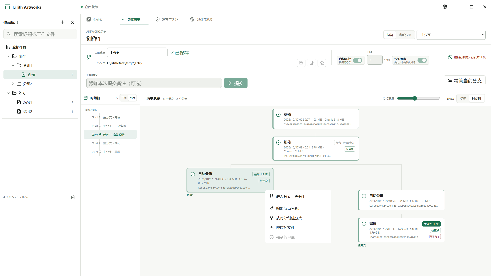

# Lilith Artworks

Lilith Artworks 是一套用于管理个人平面美术工作流中资源的工具软件，集成、轻量，**全部操作和数据均完全本地化**。

当前版本：`0.3.0-alpha.1`（repository schema v4）

  

## 主要功能

- **作品库**：统一管理大量作品数据。作品（Artwork）是本软件管理数据的核心单元，其他模块的数据都按此进行划分。作品采用 **文件/文件夹** 的模式进行管理，支持移动、排序、搜索、删除和恢复功能。
  - **可移动仓库**：自由选择一个文件夹作为数据仓库，储存所有作品和对应的数据（不包括软件的偏好设置）。可通过切换仓库路径随时切换仓库，仓库也可以方便地移动和备份；软件还支持仓库的完整性校验和垃圾清理功能。
- **工作文件版本管理**：手动或自动备份作品的工作文件（比如 psd、clip 等，支持任意格式），每次备份产生一个 **历史节点**，按先后顺序构成 **版本链**。可以方便地查看、命名和删除任意一个历史节点，也可以把任意一个历史节点的内容导出到对应文件。
  - **增量备份**：备份采用内容定义分块算法，只保存相对上一版改动过的内容，因此除首次完整快照外，每次备份新增的硬盘占用 **远小于** 工作文件本身的大小。
  - **可差分**：任意历史节点可以根据差分版本（对应另一个版本的工作文件）形成分支，不同分支交叉形成 **版本树**。版本树内所有的分支可以同时进行备份和管理。
- **素材板**：导入并存储作品的参考图像，并在一个画布中统一展示。同一作品可以有多个画板来存储不同类别的参考图像。画布中的参考图像支持移动、缩放、镜像、旋转、排列、图层、复制和导出等功能。
- **发布与认证**：给最终发布的平面作品图像嵌入 C2PA 作品信息和 TrustMark 不可见数字水印，并对这些信息进行管理。还可以识别图像中的 C2PA 和 TrustMark 信息，如果这些信息来自本软件，则可以自动匹配到对应的作品分支。

## 使用声明

> 本项目由作者在个人生产环境中 **长期持续使用**，作者承诺会在代码层面尽量做到安全与可靠。但本项目仍处于早期阶段，可能存在缺陷、稳定性问题或安全缺口，因此作者 **无法确保本软件在所有场景下的正常运行，也不对软件可能造成的数据损失承担责任**。本软件目前不适合作为作品数据的唯一副本。

### 可靠性压力测试

软件在设计上尽量保障数据的安全性，并针对 **强制结束进程、软件崩溃、长操作取消、超大仓库和工作文件、高频/高并发指令、硬盘/内存爆满** 等极端情况做了自动化压力测试，详细结论与实测数据见 [可靠性压力测试报告](docs/user/stress-test-report.md)。

### 仓库升级说明

软件打开旧版本仓库时会按迁移链自动升级到当前版本，且不支持降级。因此 **升级不可逆，打开旧版本仓库前请先备份**。

### 运行环境

- **操作系统**：Windows + WebView2（系统自带）。
- **素材板依赖显卡**：需要支持 WebGPU 与 BC7 纹理压缩的图形适配器，近年的核显/独显通常即可满足。
- **虚拟机、远程桌面或没有可用图形适配器的环境**：例如未开启 3D 加速的虚拟机，可以正常使用其余全部功能；素材板则会在画布区常驻一条「素材板不可用」的说明并注明原因。

## 开发与构建

- **环境**：Windows + Node.js 24 + 稳定版 Rust 工具链 + Microsoft C++ 生成工具 + WebView2。
- **安装依赖**：`npm ci`；**启动应用**：`npm run tauri -- dev`。完整约定见 [CONTRIBUTING.md](CONTRIBUTING.md)。
- **素材板调试**：要在真实运行中调试素材板，开发机需要支持 WebGPU 与 BC7 纹理压缩的图形适配器；没有可用适配器的虚拟机或远程桌面可以做其余模块的开发与验证。

## 文档

文档按读者分层，完整索引见 [docs/README.md](docs/README.md)。

- 使用者：[可靠性压力测试报告](docs/user/stress-test-report.md)、[安全策略](SECURITY.md)、[第三方许可摘要](THIRD_PARTY_NOTICES.md)、[变更日志](CHANGELOG.md)。
- 开发者与代理：[AI 阅读引导](docs/architecture/ai-reading-guide.md)、[系统架构](docs/architecture/overview.md)、[模块文档](docs/README.md)、[验证策略](docs/guides/validation.md)、[发行政策](docs/guides/release-policy.md)、[当前任务交接](docs/planning/current-handoff.md)、[待办清单](docs/planning/todo.md)。

## 许可证

项目贡献者创作的代码以 [GNU General Public License v3.0 only](LICENSE) 发布。分发完整应用时，需要同时满足 GPL-3.0-only 和随包第三方材料各自适用的许可与告知义务。

- 第三方软件保留各自版权和许可条款；人工维护的主要组件摘要见 [THIRD_PARTY_NOTICES.md](THIRD_PARTY_NOTICES.md)，完整的随包第三方许可清单由发行流程生成并随安装包交付（仓库内为 `licenses/THIRD_PARTY_LICENSES.html`）。
- 随包分发的 **Adobe TrustMark 模型**（`src-tauri/resources/models/`）沿用 Adobe 提供的 MIT License；原始许可文本见 [`src-tauri/resources/models/LICENSE`](src-tauri/resources/models/LICENSE)。
